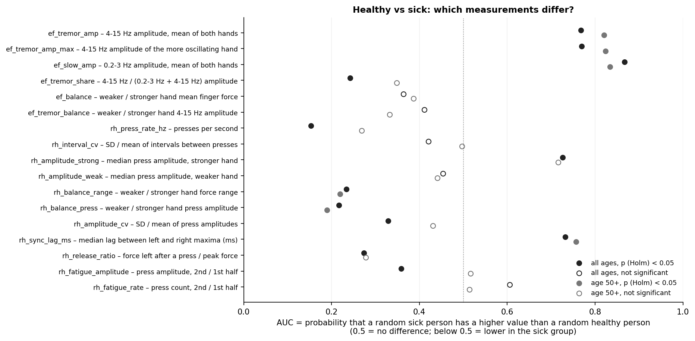
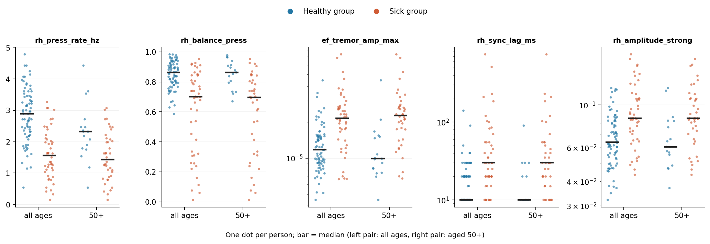
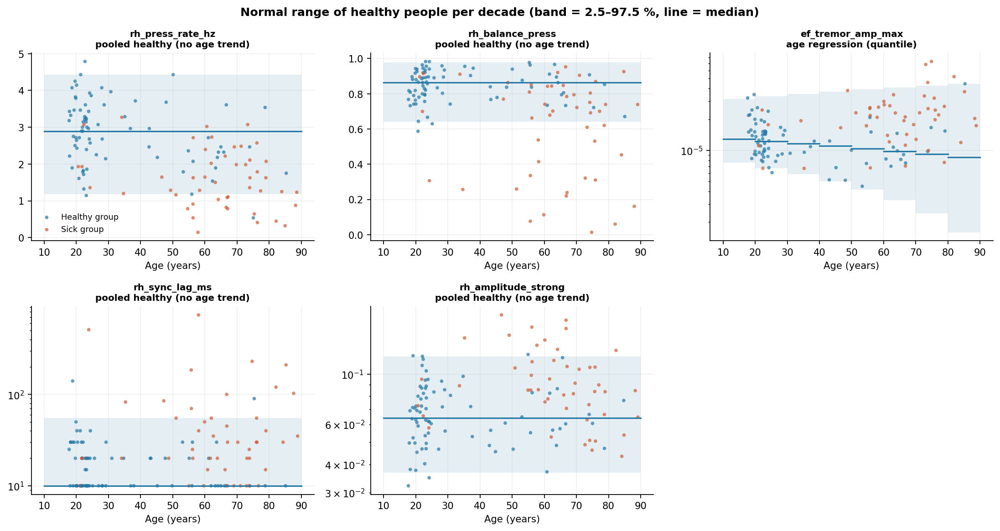
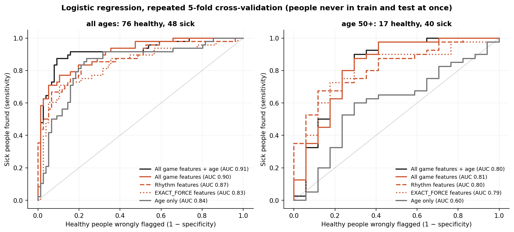
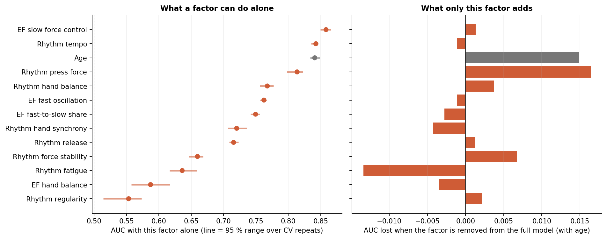

# RehaPiano: healthy vs sick participants – statistical analysis, norms and classifier

Task: formulate hypotheses and test the significance of healthy–sick differences; analyse how the measurements change with age in healthy people and set normal values and ranges per decade; propose a classifier separating healthy and sick people and an ablation of the influence of individual factors.

## Summary

- **12 of 17** measurements differ between healthy and sick people; **7** also between people of the same decade (`ef_tremor_amp`, `ef_tremor_amp_max`, `rh_press_rate_hz`, `rh_amplitude_strong`, `rh_balance_range`, `rh_balance_press`, `rh_sync_lag_ms`).

- In healthy people **3** measurements change with age; normal values per decade are given in section 4.

- A logistic regression on the game measurements separates the groups with AUC **0.90** (age alone 0.84); among people aged 50+ 0.81 vs 0.60 for age alone.

- The strongest single factor is **EF slow force control** (AUC 0.86 alone); factors are largely redundant.

- Not a diagnosis: group, age, recording period and game version coincide (section 7).

## 1. Data and methods

**Participants.** *Sick* = recruited into the patient cohort (no diagnoses available). *Healthy* = control whose questionnaire reports no condition affecting hand strength or coordination. *Other controls* (reported condition, no or duplicated questionnaire) are described but left out of every comparison. One person is one statistical unit.

| Group | People | Median age (IQR) | Aged 50+ | Female / male | Recorded | EXACT_FORCE sessions | Rhythm sessions |
|---|---|---|---|---|---|---|---|
| Healthy | 76 | 23 (21–44) | 17 | 25 / 51 | 2025-02, 2026-09 | 76 | 76 |
| Sick | 48 | 66 (56–74) | 40 | 20 / 28 | 2025-03, 2025-04, 2025-05, 2025-06, 2025-07, 2025-08 | 83 | 83 |
| Other control | 14 | 46 (23–66) | 7 | 11 / 3 | 2025-02, 2026-09 | 14 | 14 |

**Games.** EXACT_FORCE: hold a steady force with all ten fingers (4 attempts × 16 s, analysed 3–15 s). RHYTHM: press and release both hands as fast as possible (4 attempts × 31 s, analysed 2–30 s, the first attempt is practice). Used recordings: 173 EXACT_FORCE and 173 rhythm sessions.

**Preprocessing.** Decoding of the raw packets, sign correction of channel 9, timestamp checks, averaging of duplicated timestamps, interpolation of gaps ≤ 50 ms (longer gaps split the attempt), anti-aliased resampling to 100 Hz, cropping. Byte-identical copies of a recording are counted once. Oscillation amplitudes are spectrogram amplitudes computed per finger and averaged only afterwards; fingers that do not press have no oscillation value (missing, never zero). Person value = mean over sessions of the median over attempts.

**Features** (17, in 12 factors):

| Feature | Factor | Definition |
|---|---|---|
| `ef_tremor_amp` | EF fast oscillation | 4-15 Hz amplitude, mean of both hands |
| `ef_tremor_amp_max` | EF fast oscillation | 4-15 Hz amplitude of the more oscillating hand |
| `ef_slow_amp` | EF slow force control | 0.2-3 Hz amplitude, mean of both hands |
| `ef_tremor_share` | EF fast-to-slow share | 4-15 Hz / (0.2-3 Hz + 4-15 Hz) amplitude |
| `ef_balance` | EF hand balance | weaker / stronger hand mean finger force |
| `ef_tremor_balance` | EF hand balance | weaker / stronger hand 4-15 Hz amplitude |
| `rh_press_rate_hz` | Rhythm tempo | presses per second |
| `rh_interval_cv` | Rhythm regularity | SD / mean of intervals between presses |
| `rh_amplitude_strong` | Rhythm press force | median press amplitude, stronger hand |
| `rh_amplitude_weak` | Rhythm press force | median press amplitude, weaker hand |
| `rh_balance_range` | Rhythm hand balance | weaker / stronger hand force range |
| `rh_balance_press` | Rhythm hand balance | weaker / stronger hand press amplitude |
| `rh_amplitude_cv` | Rhythm force stability | SD / mean of press amplitudes |
| `rh_sync_lag_ms` | Rhythm hand synchrony | median lag between left and right maxima (ms) |
| `rh_release_ratio` | Rhythm release | force left after a press / peak force |
| `rh_fatigue_amplitude` | Rhythm fatigue | press amplitude, 2nd / 1st half |
| `rh_fatigue_rate` | Rhythm fatigue | press count, 2nd / 1st half |

## 2. Hypotheses and significance tests

For every feature: **H0** – healthy and sick people have the same distribution; **H1** – the distributions differ (two-sided). Tests: Mann–Whitney U for all ages and for people aged 50+ (17 healthy, 40 sick), and a permutation test that shuffles the healthy/sick labels only within 10-year age groups, so age cannot create the difference (2000 permutations). p-values are Holm-corrected over the 17 features. AUC = probability that a random sick person has a higher value than a random healthy one (0.5 = no difference). The same-decade effect is in standard deviations of healthy people.

| Feature | Median healthy | Median sick | AUC | p Holm (all) | p Holm (50+) | Effect, same decade (SD) | p Holm (same decade) |
|---|---|---|---|---|---|---|---|
| `ef_tremor_amp` | 1.05e-05 | 1.82e-05 | 0.77 | **< 0.001** | **0.002** | 1.11 | **0.008** |
| `ef_tremor_amp_max` | 1.17e-05 | 2.15e-05 | 0.77 | **< 0.001** | **0.002** | 1.19 | **0.033** |
| `ef_slow_amp` | 8.44e-05 | 0.000246 | 0.87 | **< 0.001** | **0.001** | 0.80 | 0.055 |
| `ef_tremor_share` | 0.10 | 0.07 | 0.24 | **< 0.001** | 0.517 | -0.44 | 0.310 |
| `ef_balance` | 0.94 | 0.89 | 0.36 | 0.054 | 1.000 | -0.43 | 1.000 |
| `ef_tremor_balance` | 0.78 | 0.76 | 0.41 | 0.294 | 0.382 | -0.31 | 1.000 |
| `rh_press_rate_hz` | 2.89 | 1.56 | 0.15 | **< 0.001** | 0.068 | -0.99 | **0.008** |
| `rh_interval_cv` | 0.21 | 0.17 | 0.42 | 0.294 | 1.000 | 0.13 | 1.000 |
| `rh_amplitude_strong` | 0.06 | 0.09 | 0.73 | **< 0.001** | 0.095 | 1.40 | **0.008** |
| `rh_amplitude_weak` | 0.05 | 0.06 | 0.45 | 0.387 | 1.000 | 0.16 | 1.000 |
| `rh_balance_range` | 0.88 | 0.73 | 0.23 | **< 0.001** | **0.012** | -1.93 | **0.018** |
| `rh_balance_press` | 0.86 | 0.70 | 0.22 | **< 0.001** | **0.003** | -2.36 | **0.008** |
| `rh_amplitude_cv` | 0.18 | 0.14 | 0.33 | **0.010** | 1.000 | -0.15 | 1.000 |
| `rh_sync_lag_ms` | 10.00 | 30.00 | 0.73 | **< 0.001** | **0.023** | 3.28 | **0.008** |
| `rh_release_ratio` | 0.20 | 0.08 | 0.27 | **< 0.001** | 0.087 | -0.35 | 0.828 |
| `rh_fatigue_amplitude` | 0.98 | 0.94 | 0.36 | **0.050** | 1.000 | -0.20 | 1.000 |
| `rh_fatigue_rate` | 0.95 | 0.96 | 0.61 | 0.191 | 1.000 | 0.30 | 1.000 |

**Result.** H0 is rejected for **12 of 17** features across all ages. Comparing people of the same decade, **7** differences remain: higher in the sick group – `ef_tremor_amp`, `rh_amplitude_strong`, `rh_sync_lag_ms`, `ef_tremor_amp_max`; lower – `rh_press_rate_hz`, `rh_balance_press`, `rh_balance_range`. Differences found only across all ages may partly reflect the age gap between the groups.

> The groups overlap: a significant difference of medians does not mean a single value separates every sick person from every healthy one.

## 3. Changes with age in healthy people

Healthy people only (n = 76). Age trend: Spearman correlation (Holm-corrected); change per 10 years from a linear fit (for amplitudes on the log scale, given in %).

| Feature | Spearman ρ | p Holm | Change per 10 years (95 % CI) | Age-dependent |
|---|---|---|---|---|
| `ef_tremor_amp` | -0.34 | 0.041 | -2.8 % (-7.1 to +1.7 %) | yes |
| `ef_tremor_amp_max` | -0.33 | 0.050 | -2.9 % (-7.3 to +1.8 %) | yes |
| `ef_slow_amp` | -0.14 | 1.000 | +4.1 % (-2.3 to +10.9 %) | no |
| `ef_tremor_share` | -0.29 | 0.130 | -0.00684 (-0.01 to -0.00238) | no |
| `ef_balance` | -0.03 | 1.000 | -0.00488 (-0.02 to 0.00878) | no |
| `ef_tremor_balance` | 0.06 | 1.000 | 0.00179 (-0.01 to 0.02) | no |
| `rh_press_rate_hz` | -0.23 | 0.573 | -0.15 (-0.25 to -0.04) | no |
| `rh_interval_cv` | -0.19 | 0.912 | -0.01 (-0.04 to 0.01) | no |
| `rh_amplitude_strong` | 0.00346 | 1.000 | -0.4 % (-3.5 to +2.8 %) | no |
| `rh_amplitude_weak` | 0.02 | 1.000 | -0.9 % (-4.5 to +2.7 %) | no |
| `rh_balance_range` | 0.08 | 1.000 | -0.00253 (-0.01 to 0.00942) | no |
| `rh_balance_press` | 0.08 | 1.000 | -0.00188 (-0.01 to 0.00964) | no |
| `rh_amplitude_cv` | -0.35 | 0.038 | -0.00628 (-0.01 to -0.000978) | yes |
| `rh_sync_lag_ms` | -0.21 | 0.756 | -2.4 % (-8.0 to +3.6 %) | no |
| `rh_release_ratio` | -0.30 | 0.126 | -0.02 (-0.04 to -0.00194) | no |
| `rh_fatigue_amplitude` | -0.20 | 0.868 | -0.00854 (-0.02 to 0.0017) | no |
| `rh_fatigue_rate` | 0.15 | 1.000 | 0.00596 (-0.00572 to 0.02) | no |

**Result.** After correction, **3 of 17** features change with age: `ef_tremor_amp` (falls, ρ = -0.34), `ef_tremor_amp_max` (falls, ρ = -0.33), `rh_amplitude_cv` (falls, ρ = -0.35). All other features do not show a detectable age trend, so one range of healthy people is valid for every decade. For `ef_tremor_amp`, `ef_tremor_amp_max` the rank correlation is significant but the size of the change is uncertain (its 95 % interval includes 0): the trend mainly contrasts the many people in their twenties with the few older healthy people. Most healthy people are in their twenties, so a weak trend in older decades could be missed.

## 4. Normal values by decade

Normal value = median of healthy people, normal range = 2.5–97.5 %. A decade gets its own empirical range only with ≥ 20 healthy people (here: 20–29). Otherwise the range of all healthy people is used for features without an age trend, and a linear quantile regression on age (evaluated at the middle of the decade) for age-dependent features. Key features (full table: `analysis/decade_norms.csv`):

| Feature | Norm from | 10–19 | 20–29 | 30–39 | 40–49 | 50–59 | 60–69 | 70–79 | 80–89 |
|---|---|---|---|---|---|---|---|---|---|
| `rh_press_rate_hz` | pooled healthy (no age trend) | 2.89 [1.17–4.43] | 2.89 [1.17–4.43] | 2.89 [1.17–4.43] | 2.89 [1.17–4.43] | 2.89 [1.17–4.43] | 2.89 [1.17–4.43] | 2.89 [1.17–4.43] | 2.89 [1.17–4.43] |
| `rh_balance_press` | pooled healthy (no age trend) | 0.86 [0.64–0.98] | 0.86 [0.64–0.98] | 0.86 [0.64–0.98] | 0.86 [0.64–0.98] | 0.86 [0.64–0.98] | 0.86 [0.64–0.98] | 0.86 [0.64–0.98] | 0.86 [0.64–0.98] |
| `ef_tremor_amp_max` | age regression (quantile) | 1.29e-05 [7.55e-06–3.18e-05] | 1.23e-05 [6.7e-06–3.36e-05] | 1.17e-05 [5.85e-06–3.55e-05] | 1.11e-05 [5e-06–3.73e-05] | 1.05e-05 [4.15e-06–3.91e-05] | 9.83e-06 [3.3e-06–4.09e-05] | 9.22e-06 [2.44e-06–4.27e-05] | 8.6e-06 [1.59e-06–4.45e-05] |
| `rh_sync_lag_ms` | pooled healthy (no age trend) | 10.00 [10.00–55.00] | 10.00 [10.00–55.00] | 10.00 [10.00–55.00] | 10.00 [10.00–55.00] | 10.00 [10.00–55.00] | 10.00 [10.00–55.00] | 10.00 [10.00–55.00] | 10.00 [10.00–55.00] |
| `rh_amplitude_strong` | pooled healthy (no age trend) | 0.06 [0.04–0.12] | 0.06 [0.04–0.12] | 0.06 [0.04–0.12] | 0.06 [0.04–0.12] | 0.06 [0.04–0.12] | 0.06 [0.04–0.12] | 0.06 [0.04–0.12] | 0.06 [0.04–0.12] |
| *healthy people in the decade* |  | 8 | 43 | 4 | 4 | 5 | 8 | 3 | 1 |

**People outside the normal range of their decade** (by construction about 5 % of healthy people):

| Feature | Healthy outside | Sick outside |
|---|---|---|
| `rh_balance_press` | 4 / 76 | 19 / 48 |
| `rh_balance_range` | 4 / 76 | 18 / 48 |
| `ef_slow_amp` | 4 / 76 | 15 / 48 |
| `rh_press_rate_hz` | 3 / 76 | 15 / 48 |
| `rh_amplitude_weak` | 4 / 76 | 14 / 48 |
| `ef_tremor_balance` | 4 / 76 | 14 / 48 |
| `rh_release_ratio` | 4 / 76 | 12 / 48 |
| `rh_sync_lag_ms` | 2 / 76 | 11 / 48 |

## 5. Classifier: healthy vs sick

Logistic regression (main model: simple and interpretable; median imputation, standardisation, balanced classes, amplitudes log-transformed) and a random forest for comparison. Evaluation: stratified 5-fold cross-validation repeated 20×; a person is never in the training and the test fold at the same time. Mean over repeats, 95 % range in brackets; threshold 0.5. Because the sick group is much older, an **age-only** model and a model on people **aged 50+** are the reference points.

| People | Features | Model | AUC (95 % range) | Balanced accuracy | Sensitivity | Specificity |
|---|---|---|---|---|---|---|
| all ages (76 / 48) | EXACT_FORCE features | logistic regression | 0.83 (0.82–0.85) | 0.76 | 0.72 | 0.80 |
| all ages (76 / 48) | Rhythm features | logistic regression | 0.87 (0.85–0.89) | 0.79 | 0.77 | 0.80 |
| all ages (76 / 48) | All game features | logistic regression | 0.90 (0.88–0.91) | 0.81 | 0.79 | 0.83 |
| all ages (76 / 48) | All game features | random forest | 0.91 (0.90–0.92) | 0.81 | 0.74 | 0.89 |
| all ages (76 / 48) | All game features + age | logistic regression | 0.91 (0.90–0.93) | 0.87 | 0.86 | 0.88 |
| all ages (76 / 48) | Age only | logistic regression | 0.84 (0.83–0.85) | 0.81 | 0.85 | 0.77 |
| age 50+ (17 / 40) | EXACT_FORCE features | logistic regression | 0.79 (0.74–0.82) | 0.72 | 0.71 | 0.74 |
| age 50+ (17 / 40) | Rhythm features | logistic regression | 0.80 (0.72–0.84) | 0.72 | 0.73 | 0.71 |
| age 50+ (17 / 40) | All game features | logistic regression | 0.81 (0.72–0.85) | 0.74 | 0.77 | 0.72 |
| age 50+ (17 / 40) | All game features + age | logistic regression | 0.80 (0.72–0.85) | 0.74 | 0.75 | 0.72 |
| age 50+ (17 / 40) | Age only | logistic regression | 0.60 (0.56–0.63) | 0.64 | 0.56 | 0.72 |

**Result.** All game features: AUC **0.90**, balanced accuracy 0.81 (permutation test: AUC with shuffled labels 0.51, p = 0.005). Age alone reaches AUC 0.84; game features plus age 0.91. Among people aged 50+, where age hardly differs, game features reach AUC **0.81** against 0.60 for age, so the measurements carry information beyond age. Largest standardised coefficients: `rh_balance_press` (-1.21), `rh_amplitude_cv` (-0.83), `rh_press_rate_hz` (-0.82), `ef_slow_amp` (+0.73).

> The classifier predicts cohort membership in this dataset; it is not a diagnostic test and has not been validated on independent data.

## 6. Ablation: influence of individual factors

Logistic regression with all factors and age (AUC 0.91). Each factor is (a) used alone and (b) removed from the full model; both with the same repeated cross-validation.

| Factor | Features | AUC alone (95 % range) | AUC lost when removed |
|---|---|---|---|
| EF slow force control | `ef_slow_amp` | 0.86 (0.85–0.87) | +0.001 |
| Rhythm tempo | `rh_press_rate_hz` | 0.84 (0.84–0.85) | -0.001 |
| Age | `age` | 0.84 (0.83–0.85) | +0.015 |
| Rhythm press force | `rh_amplitude_strong`, `rh_amplitude_weak` | 0.81 (0.80–0.82) | +0.016 |
| Rhythm hand balance | `rh_balance_range`, `rh_balance_press` | 0.77 (0.76–0.78) | +0.004 |
| EF fast oscillation | `ef_tremor_amp`, `ef_tremor_amp_max` | 0.76 (0.76–0.77) | -0.001 |
| EF fast-to-slow share | `ef_tremor_share` | 0.75 (0.74–0.76) | -0.003 |
| Rhythm hand synchrony | `rh_sync_lag_ms` | 0.72 (0.71–0.74) | -0.004 |
| Rhythm release | `rh_release_ratio` | 0.72 (0.71–0.72) | +0.001 |
| Rhythm force stability | `rh_amplitude_cv` | 0.66 (0.65–0.67) | +0.007 |
| Rhythm fatigue | `rh_fatigue_amplitude`, `rh_fatigue_rate` | 0.64 (0.62–0.66) | -0.013 |
| EF hand balance | `ef_balance`, `ef_tremor_balance` | 0.59 (0.56–0.62) | -0.003 |
| Rhythm regularity | `rh_interval_cv` | 0.55 (0.51–0.57) | +0.002 |

**Result.** Alone, the strongest factors are EF slow force control (AUC 0.86), Rhythm tempo (AUC 0.84), Rhythm press force (AUC 0.81). Removing any single factor changes the AUC by at most 0.016: the factors are largely redundant (tempo, press force and balance carry overlapping information), so the model compensates. Negative values mean the model is slightly better without that factor, a sign of mild overfitting with 17 features and few people.

## 7. Limitations

- Group membership coincides with age, recording period and game version (healthy and sick people played different step versions of both games). Differences that remain within the same decade still cannot be separated from period or game version.

- *Healthy* is questionnaire-screened, not physician-confirmed; diagnoses, severity and medication of the sick group are unknown.

- Few healthy people aged 50+; decade norms above 30 years rest on the pooled healthy range or an age regression.

- Force is in uncalibrated device units; the sensor-to-finger mapping is inferred, not verified.

- The 4–15 Hz band also contains fast force corrections, not only involuntary tremor.

## 8. Reproducibility

Generated 2026-11-01 14:13 by `python scripts/run_pipeline.py` (code version 7ab40ce + uncommitted code changes). Recording files: {"copy/identical_copy": 54, "excluded/no_metadata": 312, "excluded/step_not_analysed": 1942, "used": 346}; extraction errors: 0. Software: python 3.9.6, numpy 2.0.2, pandas 2.3.3, scipy 1.13.1, scikit-learn 1.6.1.

Tables behind every number: `outputs/pipeline/analysis/*.csv`; per-person features: `outputs/pipeline/person_features.csv`. Method details: `PIPELINE.md`.
